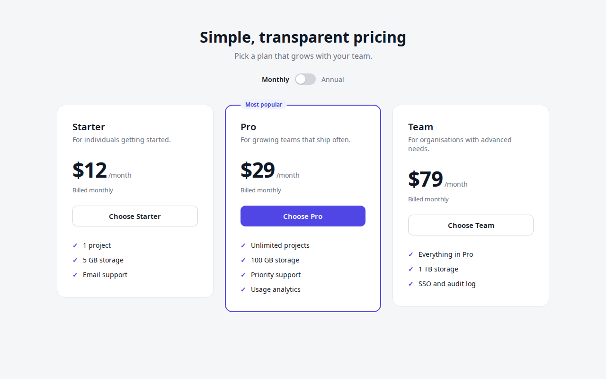

# Task 01: Pricing cards with a billing toggle

Build the pricing section shown in `reference.png`: a row of plan cards with a monthly/annual
billing switch. Annual billing takes 20% off every plan.



## Deliverable

Edit `starter/`. The grader mounts the default export of `src/PricingCards.tsx` on its own page
and passes it hidden plan data, so the component must render whatever `plans` it receives.
`src/main.tsx` is your local preview and is not graded.

```ts
// src/types.ts (do not change)
interface Plan {
  id: string;
  name: string;
  description: string;
  monthlyPrice: number; // whole dollars per month on monthly billing
  features: string[];
  highlighted?: boolean;
}
export default function PricingCards(props: { plans: Plan[] }): JSX.Element;
```

Run it with `npm run dev -- tasks/01-pricing-cards/starter` and grade it with
`npm run grade -- 01 tasks/01-pricing-cards/starter`.

## Acceptance criteria

Behaviour and accessibility

1. **AC1** The billing period is controlled by an element with role `switch` and accessible name
   "Annual billing". It is off (`aria-checked="false"`, monthly billing) on first render.
2. **AC2** The switch is the first element in the tab order. Space and Enter toggle it while
   focused; so does clicking it. `aria-checked` always reflects the current state.
3. **AC3** Each plan is an `article` whose accessible name is the plan name, with the name as a
   level-3 heading followed by the description. Plans appear in the order given.
4. **AC4** On monthly billing each card shows its price as `$<monthlyPrice>/month` and the note
   "Billed monthly".
5. **AC5** On annual billing each card shows `$<round(monthlyPrice × 0.8)>/month` and the note
   "Billed $<that × 12> yearly". Amounts use US formatting with thousands separators
   (`$1,428`). Rounding is to the nearest whole dollar.
6. **AC6** A "Save 20%" badge is visible next to the switch while annual billing is on, and
   not shown while it is off.
7. **AC7** The plan with `highlighted: true` (at most one) shows a "Most popular" label. No other
   card does.
8. **AC8** Each card has a button named "Choose <plan name>" and a list of its features, one
   list item per feature.

Layout

9. **AC9** From 768px wide the cards sit in one row with equal widths. Below 768px they stack in
   a single column, each spanning the content width (24px side padding), with no horizontal
   page scroll at 375px.
10. **AC10** At 1280×800 the default plans match `reference.png`. At most 1% of pixels may
    differ by more than the per-pixel colour threshold of 0.1 (Playwright `toHaveScreenshot`).

Design tokens from the mockup: page background `#f5f6f8`, 56px top padding, content width
1040px, card gap 24px; cards are white with a 1px `#e5e7eb` border, 16px radius and 32px
padding; the highlighted card has a 2px `#4f46e5` border and a pill label overlapping its top
edge (`#eef2ff` on `#4338ca`, 12px semibold). Title 32px bold, plan name 20px semibold, price
44px bold, muted text `#6b7280`. The switch is 44×24px, grey `#d1d5db` when off and `#4f46e5`
when on. The badge is `#dcfce7` on `#166534`. Font: `system-ui, sans-serif`.

## Constraints

- React and TypeScript (strict). No dependencies beyond `react` and `react-dom`; the grader
  rejects any other import, and any import from outside your submission directory.
- The component imports its own CSS. The grader page provides only `body { margin: 0 }`.
- Keep `src/types.ts` as given; the grader typechecks your component against it.

## Out of scope

Checkout behaviour behind the "Choose" buttons, currencies other than USD, persisting the
billing choice, dark mode and animation.
