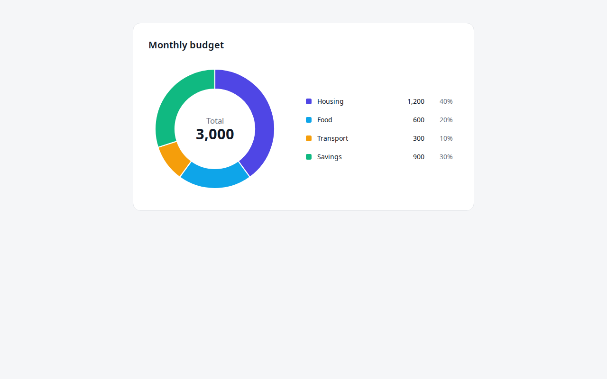

# Task 02: Interactive SVG donut chart

Build the chart card shown in `reference.png`: an SVG donut chart with a centre total and a
legend. Pointing at or focusing a segment shows a tooltip and highlights its legend row.



## Deliverable

Edit `starter/`. The grader mounts the default export of `src/DonutChart.tsx` and passes it
hidden data sets of different sizes, labels, values and colours. Everything shown must be
derived from `title` and `data`. `src/main.tsx` is your local preview and is not graded.

```ts
// src/types.ts (do not change)
interface Segment {
  id: string;
  label: string;
  value: number; // non-negative; at least one segment is positive
  color: string; // any CSS colour
}
export default function DonutChart(props: { title: string; data: Segment[] }): JSX.Element;
```

Run it with `npm run dev -- tasks/02-donut-chart/starter` and grade it with
`npm run grade -- 02 tasks/02-donut-chart/starter`.

Below, a segment's percentage is `round(value / total × 100)` and numbers use US formatting
with thousands separators (`1,200`).

## Acceptance criteria

Structure and geometry

1. **AC1** The chart is a square `<svg>` with role `group` whose accessible name is `title`.
   Inside it, each segment is an element with role `img` and accessible name
   `"<label>: <value> (<percent>%)"`, e.g. `Housing: 1,200 (40%)`, in data order.
2. **AC2** Segments form a ring centred in the SVG, with outer radius 45% and inner radius 30%
   of the SVG's width. They run clockwise from 12 o'clock in data order, each spanning an angle
   proportional to its value.
3. **AC3** The centre of the ring shows the word "Total" and the sum of all values.
4. **AC4** A list with accessible name "Legend" has one item per segment, in data order, showing
   a colour swatch, the label, the value and the percentage.

Interaction and accessibility

5. **AC5** Moving the pointer onto a segment shows a tooltip (role `tooltip`) with its label,
   value and percentage, and marks its legend row with `aria-current="true"` plus a visible
   background highlight. Other rows are not marked. Leaving the chart hides the tooltip and
   clears the highlight.
6. **AC6** Exactly one segment is in the tab order; with nothing else focusable on the page,
   the first Tab focuses the first segment. ArrowRight/ArrowDown focus the next segment and
   ArrowLeft/ArrowUp the previous one, wrapping at both ends; Home and End focus the first and
   last. One more Tab moves focus out of the chart.
7. **AC7** The focused segment shows its tooltip and legend highlight exactly as on hover.
   Escape hides the tooltip and keeps focus on the segment.

Layout

8. **AC8** From 640px wide the legend sits to the right of the chart. Below 640px it sits below
   the chart, the chart fits the viewport and the page does not scroll horizontally at 375px.
9. **AC9** At 1280×800 the default data matches `reference.png`. At most 1% of pixels may differ
   by more than the per-pixel colour threshold of 0.1 (Playwright `toHaveScreenshot`).

Design tokens from the mockup: page background `#f5f6f8` with 48px top padding; a white card,
720px max width, 32px padding, 1px `#e5e7eb` border, 16px radius. Title 20px semibold, 24px
below it. The chart is 280px wide with a 40px gap to the legend; segments have a 1.5px white
separator (in the 200-unit viewBox). "Total" is 12px muted `#6b7280`, the sum 22px bold.
Legend rows are 14px with 10px × 12px padding, a 12px swatch with 3px radius, and
right-aligned values and muted percentages; the highlighted row background is `#eef2ff`.
Tooltip: `#111827` background, white 13px text, 8px radius. Font: Noto Sans, which the page loads in weights 400, 600 and 700 (`font-family: 'Noto Sans', sans-serif`).

## Constraints

- React and TypeScript (strict), drawn with SVG. No dependencies beyond `react` and
  `react-dom`; the grader rejects any other import, and any import from outside your
  submission directory.
- The component imports its own CSS. The grader page provides only `body { margin: 0 }` and the Noto Sans font faces.
- Keep `src/types.ts` as given; the grader typechecks your component against it.

## Out of scope

Animation, hovering the legend to highlight a segment, empty or all-zero data, segment labels
drawn on the ring, and dark mode.
