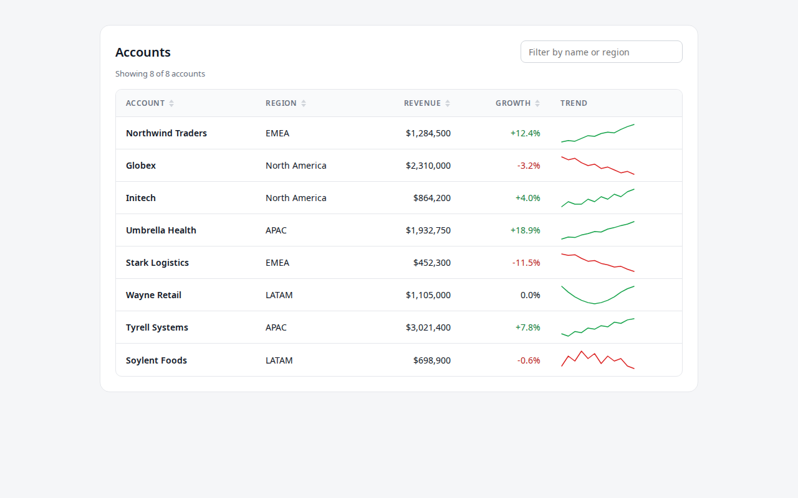

# Task 03: Sortable, filterable accounts table with canvas sparklines

Build the accounts table shown in `reference.png`: a filter box, a live result count, sortable
columns, a sticky header, a `<canvas>` sparkline per row and empty states.



## Deliverable

Edit `starter/`. The grader mounts the default export of `src/DataTable.tsx` and passes it
hidden data sets, including an empty one and one long enough to scroll. Everything shown must
be derived from `rows`. `src/main.tsx` is your local preview and is not graded.

```ts
// src/types.ts (do not change)
interface Account {
  id: string;
  name: string;
  region: string;
  revenue: number; // whole US dollars
  growth: number; // percentage change, e.g. 12.4 for +12.4%
  trend: number[]; // weekly revenue, oldest first, at least two points
}
export default function DataTable(props: { rows: Account[] }): JSX.Element;
```

Run it with `npm run dev -- tasks/03-data-table/starter` and grade it with
`npm run grade -- 03 tasks/03-data-table/starter`.

## Acceptance criteria

Table and formatting

1. **AC1** A `<table>` with accessible name "Accounts" has column headers Account, Region,
   Revenue, Growth and Trend, and one row per account in the order given (until sorted).
2. **AC2** Revenue is US currency with no decimals (`$1,284,500`). Growth has one decimal place
   and a sign: `+12.4%`, `-3.2%`, and `0.0%` for values that round to zero. Use
   `Intl.NumberFormat('en-US')` with `signDisplay: 'exceptZero'` semantics.

Sorting

3. **AC3** The Account, Region, Revenue and Growth headers each contain a button named after
   the column. Activating it sorts by that column ascending; activating it again sorts
   descending; activating another column's button sorts that column ascending. The sorted
   header has `aria-sort="ascending"` or `"descending"`; no other header claims a sort. Text
   sorts case-insensitively (`localeCompare(…, 'en', { sensitivity: 'base' })`), numbers
   numerically, and ties keep their original order in both directions.
4. **AC4** Sorting works from the keyboard: the sort buttons follow the filter box in tab order,
   in column order, and Enter or Space activates them.

Filtering and empty states

5. **AC5** A search input with accessible name "Filter accounts" keeps the rows whose name or
   region contains the query, ignoring case and surrounding whitespace, in the current sort
   order. An element with role `status` reads "Showing N of M accounts".
6. **AC6** When nothing matches, the table body shows one row reading
   `No accounts match “<query>”.` (curly quotes, trimmed query) with a "Clear filter" button
   that empties the filter, restores all rows and moves focus to the filter box. With no
   accounts at all it reads "No accounts yet." and offers no button.

Sparklines

7. **AC7** Each row's Trend cell has a 120×32 CSS-pixel `<canvas>` with role `img` and accessible
   name `Trend for <name>, <direction>`, where direction is `up` if the last point is above the
   first, `down` if below and `flat` otherwise. It draws a 2D line through the points, evenly
   spaced across the width, with the maximum at the top and the minimum at the bottom (2px
   padding); a constant series is a horizontal line through the middle. Green `#16a34a` unless
   the direction is down, then red `#dc2626`. Scale the backing store by `devicePixelRatio`.
8. **AC8** After any sort or filter, every sparkline still shows its own row's data.

Layout

9. **AC9** The table sits in a container with a maximum height of 480px that scrolls; the header
   row stays pinned to the top of it while rows scroll underneath.
10. **AC10** At 375px wide the page does not scroll horizontally: the table scrolls sideways
    inside its container, and the filter box fits the viewport.
11. **AC11** At 1280×800 the default data matches `reference.png`. At most 1% of pixels may
    differ by more than the per-pixel colour threshold of 0.1 (Playwright `toHaveScreenshot`).

Design tokens from the mockup: page background `#f5f6f8` with 40px top padding; a white card,
960px max width, 24px padding, 1px `#e5e7eb` border, 16px radius. Title 20px semibold; the
filter box is 260×36px with an 8px radius; the status line is 13px muted `#6b7280`. The table
container has a 1px border and 10px radius. Header row 44px, `#f9fafb`, 12px uppercase muted
semibold with 0.04em letter spacing, with a two-triangle sort icon; body rows 52px, 14px, cells
padded 16px horizontally, 1px row dividers. Account names are semibold; numeric columns are
right-aligned with tabular figures. Positive growth `#15803d`, negative `#b91c1c`. Font:
`system-ui, sans-serif`.

## Constraints

- React and TypeScript (strict); sparklines use the Canvas 2D API. No dependencies beyond
  `react` and `react-dom`; the grader rejects any other import, and any import from outside
  your submission directory.
- The component imports its own CSS. The grader page provides only `body { margin: 0 }`.
- Keep `src/types.ts` as given; the grader typechecks your component against it.

## Out of scope

Pagination, row selection, column resizing, persisting sort or filter in the URL, sparkline
tooltips, and dark mode.
